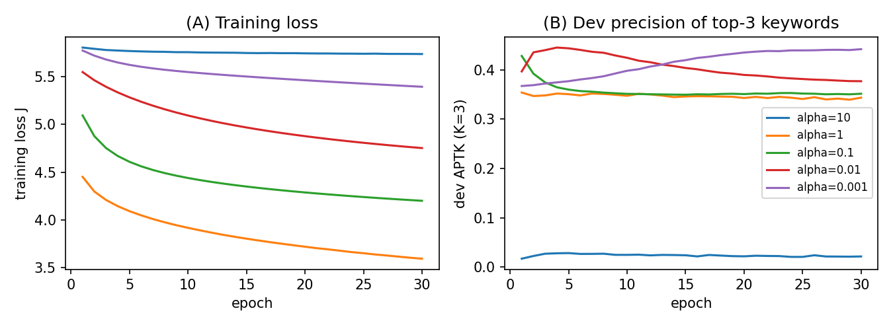
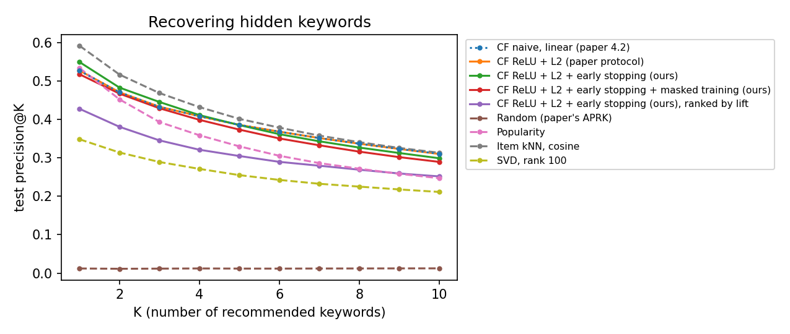
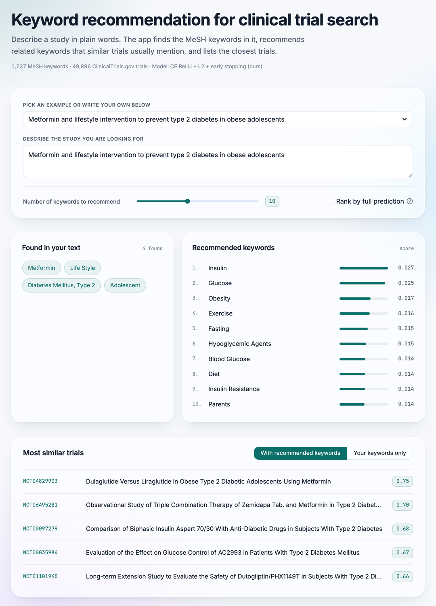

# Keyword recommendation for clinical trial records

Mini-project 14 for UE24CS352A Machine Learning, PES University.
Section B, team B-06: Dhanush Shankar Reddy (PES1UG24AM083) and Harshith R (PES1UG24AM117).

People who search for clinical trials similar to their own rarely type every relevant medical
term. This project suggests the missing ones. A free-text query is mapped to
[MeSH](https://meshb.nlm.nih.gov/) keywords, the controlled vocabulary of the US National Library
of Medicine, and a collaborative filtering model trained on ClinicalTrials.gov records predicts
which other keywords usually appear with them. The suggested keywords can be added to the query
before searching.

The method comes from Xiao Zhou's Stanford CS229 project
[Collaborative Filtering on Keywords Recommendation for Clinical Trial Records](https://cs229.stanford.edu/proj2020spr/report/Zhou.pdf)
(2020). We wrote our own implementation from the paper in NumPy, trained it on 50,000 current trial
records and compared it with baselines the paper did not test.

## Results

These are test-set results on 4,989 trials. Half of each trial's keywords are hidden and every
method tries to recover them from the other half. P@K is the share of a method's top K new keywords
that really were in the trial, and P@3 is the paper's APTK. IDF@3 is the mean IDF of the top three
keywords, so higher means more specific. MSE and MSER are the paper's error measures, listed for the
CF models.

| Method | P@1 | P@3 (APTK) | P@10 | IDF@3 | MSE | MSER |
|---|---:|---:|---:|---:|---:|---:|
| Random (the paper's APRK) | 0.012 | 0.012 | 0.012 | 1.87 | | |
| Popularity | 0.535 | 0.394 | 0.247 | 0.29 | | |
| SVD, rank 100 | 0.349 | 0.290 | 0.212 | 1.52 | | |
| Item kNN, cosine | 0.593 | 0.469 | 0.314 | 0.59 | | |
| CF naive, linear (paper) | 0.528 | 0.433 | 0.311 | 0.87 | 0.0086 | 0.0090 |
| CF ReLU + L2 (paper protocol, 60 epochs) | 0.528 | 0.434 | 0.311 | 0.87 | 0.0086 | 0.0091 |
| CF + early stopping (ours, 33 epochs) | 0.550 | 0.446 | 0.299 | 0.65 | 0.0087 | 0.0088 |
| CF + early stopping + masked training (ours) | 0.518 | 0.430 | 0.290 | 0.58 | 0.0087 | 0.0087 |
| CF + early stopping, ranked by lift (used in the demo) | 0.428 | 0.346 | 0.252 | 1.18 | | |

All CF rows use τ = −1, k = 16, λ = 10⁻⁴ (0 for the naive model) and a learning rate of 0.001,
chosen on the dev set. The full search log is in `results/train_log.txt`.



What we found:

- The model works as the paper describes. It recovers hidden keywords 36 times as often as
  random choice, similar to the paper's own result (APTK 0.479 against APRK 0.017 with 947
  keywords).
- Comparing only against random choice, as the paper does, hides how much comes for free.
  Recommending the most common keywords to every trial already scores 0.394, and item kNN, which
  needs no training, beats every CF variant at every K from 1 to 10.
- Training loss and recommendation quality disagree. The loss keeps falling, but dev precision
  peaks within a few epochs and then drops (figure above). The paper suggests longer training might
  help because its loss was still falling; on our data it does not. Scoring every run after a fixed
  30 epochs, as the paper does in its learning-rate search, picks the slowest learning rate because
  it is the only one that has not started to overfit. Choosing the number of epochs on the dev set gives the best CF result, 0.446.
- Masked training did not help with the tuned settings. Its dev score was still rising after 60
  epochs and ended below the early-stopped model.
- The weights W add little. The paper's own final setting (τ = −0.001, k = 1000) makes W almost
  exactly 1 for every pair and scores 0.447 on dev, against 0.452 for the best setting in our grid.
- Precision rewards generic keywords such as *Patients* and *Therapeutics*, which is why popularity
  does so well. Ranking by lift, as the demo does, raises the specificity of the top keywords from
  IDF 0.65 to 1.18 and costs 0.10 in precision.



## Demo

The web demo finds the MeSH keywords in a query, recommends new ones and lists the most similar
trials. In this example the extractor misses "obese" because it is not a MeSH entry term, and the
model recommends *Obesity* anyway.



## How it works

1. `src/fetch_data.py` downloads 50,000 trial records from the
   [ClinicalTrials.gov API](https://clinicaltrials.gov/data-api/api) and the 2026 MeSH descriptor
   file. From each trial it keeps the six sections the paper uses: brief title, official title,
   brief summary, detailed description, conditions and eligibility criteria.
2. `src/mesh.py` loads the 30,512 topical MeSH descriptors with all
   265,712 of their names and synonyms into a token trie, then scans each trial left to right and
   keeps the longest match at each position. "breast cancer", "Breast Carcinoma" and
   "Neoplasms, Breast" all become the descriptor *Breast Neoplasms*. All-caps abbreviations are
   matched case-sensitively, so the "who" in "patients who..." is not read as WHO, the World
   Health Organization. We also drop 50 single words whose usual meaning in trial text is not their MeSH sense: "will"
   is not *Volition*, and a study "arm" is not the body part. We found them by checking the 400
   most frequent single-word matches by hand.
3. `src/build_matrix.py` builds the utility matrix
   U<sub>ij</sub> = log<sub>10</sub>(1 + count of keyword i in trial j) · log<sub>10</sub>(N / trials containing keyword i).
   As in the paper, only keywords found in at least 0.5% of trials are kept, which leaves 1,237
   keywords. Trials need at least two keywords, which leaves 49,896 trials, split 80/10/10 into
   train, dev and test sets.
4. `src/model.py` predicts each keyword's TF-IDF from the other keywords in the same
   trial, R̂ = ReLU((W ⊙ Θ)R + b). W is fixed and comes from the cosine similarity between keywords,
   W<sub>if</sub> = exp(τ(1 − cos(R<sub>i</sub>, R<sub>f</sub>))<sup>k</sup>) with W<sub>ii</sub> = 0. Θ and b are learned by mini-batch
   gradient descent on squared error with an L2 penalty on Θ. The paper's "naive" model is the same
   thing without the ReLU and the penalty.
5. `src/evaluate.py` hides half of each test trial's keywords and checks how many
   of the model's top K new keywords were really there (precision@K). For K = 3 this is the
   paper's APTK, and choosing keywords at random gives its APRK. It also has the paper's MSE and
   MSER, and four baselines: random, popularity, item kNN and SVD.
6. `src/train.py` repeats the paper's tuning procedure: a learning-rate search,
   then a grid over τ, k and λ, each run for 30 epochs, then a 60-epoch final model. It also runs
   our two changes, early stopping and masked training. All choices are made on the dev set.
7. `src/recommend.py` (command line) and `app.py` (Streamlit web page) take a query,
   show the MeSH keywords found in it, recommend new ones, and list the most similar trials with
   and without the recommended keywords.

## Setup

You need Python 3.10 or newer. The downloaded data and trained model take about 100 MB.

```bash
git clone https://github.com/dhanush-sr/ml-mini-project.git
cd ml-mini-project
python3 -m venv .venv
source .venv/bin/activate          # on Windows: .venv\Scripts\activate
pip install -r requirements.txt
```

## Usage

Run these from the repository root, in this order. Times are from an Apple M4 laptop.

```bash
python -m src.fetch_data           # download MeSH and 50,000 trials (about 3 minutes, 78 MB)
python -m src.build_matrix         # extract keywords, build the TF-IDF matrix (about 30 seconds)
python -m src.train --quick        # train the final models with the saved search results (about 2 minutes)
```

`python -m src.train` without `--quick` reruns the whole hyperparameter search first, which takes
about 30 minutes. The search results we got are saved in `results/search.json`, and `--quick`
reuses them.

Then try the model:

```bash
python -m src.recommend "Metformin and lifestyle intervention to prevent type 2 diabetes in obese adolescents"
streamlit run app.py               # opens the web demo at http://localhost:8501
```

By default keywords are ranked by how much the query raises them above their usual level. Add
`--generic` (or tick the box in the web demo) to rank by the raw prediction, which puts common
keywords such as *Patients* first.

ClinicalTrials.gov keeps changing, so a fresh download gives a slightly different set of trials
and slightly different numbers from the ones below.

## Running on Google Colab

`colab_run.ipynb` runs every step above on Colab with a CPU runtime. Upload it to Colab, set
`REPO_URL` in the first code cell to this repository, and choose Runtime > Run all. To get exactly the
numbers in this README, upload `trials.jsonl.gz` and `desc2026.gz` from the original run into
`project/data/` before the download cell; otherwise it downloads fresh data.

The same notebook also runs on your own computer in Jupyter or VS Code. Open it from the
repository folder and the first cell skips getting the code.

## Tests

```bash
python -m pytest -q                # or: python tests/test_core.py
```

The tests need no downloaded data. They compare the hand-derived gradients with finite
differences, check the TF-IDF formula, the keyword extractor, the masking and the metrics.

## Report

`report/report.pdf` is printed from `report/report.html`. To rebuild it after an edit, open the HTML
file in Chrome and print to PDF with headers and footers turned off, or on macOS run:

```bash
cd report
"/Applications/Google Chrome.app/Contents/MacOS/Google Chrome" --headless --no-pdf-header-footer \
  --allow-file-access-from-files --print-to-pdf=report.pdf "file://$PWD/report.html"
```

## Project structure

```
app.py                  Streamlit web demo
colab_run.ipynb         runs the whole project on Google Colab
src/fetch_data.py       download trial records and MeSH
src/mesh.py             MeSH loading and keyword extraction (token trie)
src/build_matrix.py     TF-IDF utility matrix and train/dev/test split
src/model.py            collaborative filtering model and gradient descent
src/evaluate.py         masked evaluation, metrics and baselines
src/train.py            hyperparameter search, final training, test results
src/recommend.py        keyword recommendation and similar-trial search
tests/test_core.py      self-checks
results/                metrics, search log and plots (committed)
report/report.pdf       project write-up (source: report/report.html)
data/, models/          downloaded data and trained model (not committed, rebuilt by the scripts)
```

## Limitations

- Many recent drugs, such as pembrolizumab, exist only as MeSH supplementary concepts and not as
  descriptors, so the extractor does not see them.
- Adjective forms are not always MeSH entry terms. "metastatic", for example, is not matched to
  *Neoplasm Metastasis*.
- The model only knows the 1,237 keywords that appear in at least 0.5% of trials. Rarer keywords
  in a query are shown but not used.
- The 50,000 trials are the first 50,000 the API returned, not a random sample of the whole
  registry. The train, dev and test split within them is random.
- The keyword list and the IDF weights are computed from all 49,896 trials, test trials included.
  The hidden keywords are never given to a model, but the test trials do slightly affect which
  keywords are kept and how they are weighted.

## References

1. Xiao Zhou. *Collaborative Filtering on Keywords Recommendation for Clinical Trial Records.*
   CS229 project report, Stanford University, 2020.
2. ClinicalTrials.gov API, U.S. National Library of Medicine. https://clinicaltrials.gov/data-api/api
3. Medical Subject Headings (MeSH) 2026, U.S. National Library of Medicine. https://www.nlm.nih.gov/mesh/
